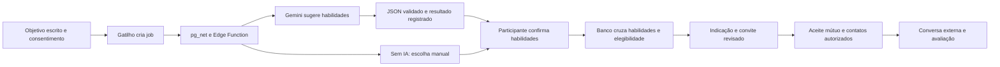

# Validação da recomendação por habilidades

## Finalidade atual — objetivo escrito e habilidades (037–039)

A validação agora avalia **a inferência de habilidades úteis para um objetivo escrito**, antes de buscar pessoas. O Gemini não recebe o pool nem decide a pessoa indicada. `objective.ts` contém SYSTEM/SYSTEM_V2, esquema, minimização e validação usados também no instrumento `rodar.ts`. A ordem das pessoas resulta de cruzamento determinístico **local**, depois das habilidades; `indicacoes_IA` no CSV é esse resultado derivado, não uma escolha generativa de pessoas.

Critérios definidos antes dos testes: (1) habilidades propostas ajudam no objetivo; (2) não omitem a necessidade principal; (3) são de uma a três, do catálogo, sem repetição; (4) objetivo insuficiente pode produzir lista vazia e escolha manual; (5) nenhum dado pessoal é enviado. Caso aprovado = duas de três avaliadoras marcam aprovado, com todos os vereditos preenchidos para calcular a taxa.

O campo `objetivo` aceita o enunciado profissional; `apoio_texto`, quando preenchido, é o texto usado pela IA (até 300 caracteres). `pede_interesses` permanece só por compatibilidade com a planilha anterior, fica vazio e é ignorado. O pool fica só no computador para ilustrar o cruzamento após habilidades. Nenhuma simulação confirma a decisão da participante no site.

O plano B do instrumento faz reconhecimento **literal** de expressões de vocabulário profissional fechado, para comparação controlada sem geração. No produto, sem IA, a participante escolhe manualmente: são bases de comparação distintas. Registrar essa diferença no pitch. As avaliadoras comparam A (habilidades inferidas) com B (reconhecimento literal), além de conferir se a primeira pessoa derivada ajudaria; não atribuir à IA o desempate determinístico. O script consolida em quantos casos A foi aprovado e B não, taxas e diferença entre rodadas.

Os dados reais, vinte casos, três avaliadoras e duas rodadas continuam pendentes. O teste local usa respostas stub e apaga casos fictícios. A consulta remota de 17/11 encontrou 11 perfis, três com habilidades e nenhum job; não é evidência de geração. O diagnóstico de metadados do Gemini descrito abaixo também não é geração.


Revisão: 17/11/2026. Entrega: 18/11 às 12h de Brasília. Os resultados abaixo distinguem implementação, teste local e comprovação com pessoas reais.

## Problema, público e critérios

O público inclui mulheres cis e trans e pessoas não binárias de todas as áreas e momentos de carreira. Os estudos históricos da landing contextualizam redes profissionais, mas não comprovam necessidade ou eficácia da aliadas. O objetivo é facilitar uma conversa profissional útil, sem mentoria formal.

As três avaliadoras registram aprovado, ajustar ou reprovado e comentário. Meta proposta: 80% dos casos aprovados e nenhum incidente de privacidade; isso é um critério de sucesso, não resultado medido. Critérios vigentes estão definidos no início deste documento, antes das rodadas.

## Preencher os arquivos

- `validacao/pool.csv`: até 15 perfis reais, autorizados e anonimizados. Código C1…C15, situação, área, até oito ids de habilidades separados por `|` e consentimento `sim`. Não colocar nomes, fotos, contatos ou ids Supabase. O arquivo não faz concessão de consentimento por si só: guarde a autorização fora do repositório público.
- `validacao/casos.csv`: 20 casos reais higienizados, com código CASO01…CASO20, objetivo, apoio até 300 caracteres, situação, área e observação; interesses permanece vazio. Incluir três ou quatro difíceis: Outro, texto vago, necessidade sem habilidade no pool. A observação não vai à IA.
- Os dois arquivos contêm somente cabeçalho e uma linha-modelo comentada. Dados fictícios dos testes ficam em diretório temporário e são apagados.
- Chaves permitidas: `src/lib/professional.ts`; catálogo e mapa: `src/lib/habilidades.ts`, reexportados do arquivo compartilhado com o worker.

## Rodar sem alterar produção

O script usa o **mesmo SYSTEM, esquema com enums, minimização e validação de objective.ts** da Edge Function. O texto bruto não sai para o Google: após retirar contatos/documentos, só são transmitidas expressões de vocabulário profissional fechado. Isso protege nomes que um filtro de telefones não reconheceria, mas pode perder nuances; avaliar também essa limitação.

Configure a chave apenas no ambiente seguro local, nunca no CSV, Git ou chat. Use o mesmo modelo publicado, em projeto Google sem faturamento, e `GEMINI_FREE_TIER_CONFIRMED=true`.

```bash
deno run --allow-read --allow-write=validacao --allow-env \
  --allow-net=generativelanguage.googleapis.com \
  validacao/rodar.ts --rodada 1 --versao-prompt v1 --geracoes-produto-hoje 0

deno run --allow-read --allow-write=validacao --allow-env \
  --allow-net=generativelanguage.googleapis.com \
  validacao/rodar.ts --rodada 2 --versao-prompt v2 --geracoes-produto-hoje 0

deno run --allow-read --allow-write=validacao validacao/consolidar.ts
```

Substitua `0` pelo número real de gerações do produto naquele dia, conferido no painel. Some outras pastas/rodadas manuais. O script limita o consumo local e não deve ser executado em paralelo; não controla sozinho a soma de outros computadores e produção. Distribua 40 casos das duas rodadas em dias distintos para respeitar o limite de 30 gerações/dia e as cotas gratuitas reais. Não habilite cobrança. O script é **parte manual declarada**, não substitui as três execuções do gatilho pelo site.

Saídas: `avaliacao-rodada-N.csv`, com objetivo, apoio, habilidades, pool e indicação ordenada em português, colunas A1/A2/A3; `saidas-rodada-N.csv`, só código de caso, modelo, versão, tokens, hora e código de erro. Salva incrementalmente e não sobrescreve rodadas existentes.

SYSTEM_V2 está preparado e ainda é igual ao SYSTEM. Ajustá-lo depois dos comentários reais da rodada 1 e registrar a mudança. Usar os mesmos casos/pool na rodada 2; se mudarem, explicar a comparabilidade. Não fabricar melhoria.

## O que se perde sem a IA

O script gera `indicacoes_plano_B` para os mesmos casos sem nova chamada externa. As três avaliadoras registram também B1/B2/B3_veredito e comentário, usando os mesmos critérios. A consolidação informa:

- Taxa de aprovação de cada rodada e diferença em pontos percentuais.
- Casos em que a IA foi aprovada e a regra não foi, entre casos com ambos os métodos completamente avaliados.
- Casos em que a regra foi aprovada e a IA não foi; regressões entre rodadas.
- Comentários agrupados e vereditos faltantes.

No pitch, usar “A IA ajudou em X de Y casos comparáveis em que a regra não foi aprovada” **somente depois da avaliação real**. A hipótese é interpretar a necessidade para além do reconhecimento literal, não escrever mensagens mais bonitas.

## Três execuções reais da automação

O gatilho começa quando uma participante registra um objetivo com consentimento atualizado. O banco cria um job → pg_net chama conversa-ia → Gemini infere habilidades → validação rejeita ids estranhos/repetidos → banco salva resultado, modelo, tokens e estado → participante revisa → só depois o banco busca pessoas. A IA não depende da existência de candidatas nem de seus consentimentos, pois não recebe seus dados.

Em Painel › IA e automações, exportar três jobs distintos com data, etapa, tentativa, estado concluído, modelo, tokens, habilidades retornadas e identificador de execução. Falha com zero tokens, escolha manual, stub e consulta de metadados não comprovam geração. Tentativas alternativas do mesmo objetivo são execuções reais do gatilho de atualização, mas não devem ser descritas como três participantes, três casos distintos ou avaliação humana. Se a banca exigir três solicitações independentes, executar mais três objetivos reais pelo site dentro das cotas.

Situação anterior à publicação: zero jobs. A titular autorizou nesta conversa o processamento informado e um teste real com seu objetivo de melhorar a experiência do site e organizar o painel. Evidências posteriores serão anexadas em `docs/EVIDENCIAS-IA.md`, sem dados pessoais.

## Entrevistas e demonstração

Entrevistas: quando precisou de uma conversa profissional; como buscou ajuda; se conseguiu; tempo gasto; o que tornaria a troca útil. Colher consentimento e só guardar síntese higienizada. Ainda não há resultados de entrevistas, linha de base de tempo ou benefício mensurado.

Pitch até cinco minutos: problema/público e evidência (45s), solução e quatro componentes (45s), demonstração até dois minutos, comparação IA × regra e validação (45s), custos/limitações/próximo passo (45s). Não apresentar metas como resultados.



## Evidências e pendências

Consulta somente de leitura em 17/11: havia seis perfis profissionais e cinco com consentimento legado; consulta seguinte encontrou sete disponíveis. O conjunto pode mudar durante os testes. Não existiam jobs nem tokens registrados nessas consultas. Os três secrets estavam presentes. Presença de secrets e confirmação da titular de projeto sem faturamento não comprovam cota ou resposta Gemini.

Testes locais: build/TypeScript, SQL/RLS, contratos de IA, worker Deno sem rede externa, navegador com Auth/API simulados, script com Gemini stub e duas rodadas sintéticas temporárias. Não equivalem a testes humanos nem a execução real da API.

| Requisito | Implementado | Comprovado | Pendente | Próxima ação |
|---|---|---|---|---|
| Banco com RLS e contatos após aceite | Sim | Testes locais de autorização | Revisão pós-publicação | Conferir políticas remotas |
| Automação por gatilho | Sim | Três jobs reais concluídos, ver EVIDENCIAS-IA.md | Demonstração pela interface com participantes | Registrar próximos testes reais |
| IA por habilidades | Sim | Três respostas reais, modelo, tokens e habilidades gravados | Qualidade avaliada por humanas | Vinte casos e duas rodadas |
| Revisão humana antes do convite | Sim | Navegador simulado | Teste com participantes | Revisar e enviar pelo site |
| 20 casos e três avaliadoras | Instrumentos prontos | Script testado com stub | Preenchimento/avaliação reais | Preencher pool/casos e convidar avaliadoras |
| Duas rodadas e comparação IA × regra | Sim | Consolidação local | Resultados reais | Avaliar, ajustar SYSTEM_V2, repetir |
| Entrevistas e linha de base | Roteiro pronto | Sem coleta | Dados reais | Realizar entrevistas autorizadas |
| Benefício mensurável | Indicadores prontos | Sem resultado | Medições de utilidade/tempo | Coletar feedback sem presumir encontros |
| Custos e cenário 10× | Sim | Consumo DB consultado | Cotas/faturas atuais | Conferir fontes/painéis |
| LGPD e segurança | Controles/documentação | Testes locais | Configuração de senha vazada | Ver docs/SEGURANCA.md |
| Pitch e demonstração | Roteiro pronto | Sem ensaio real | Gravação até 2min dentro de 5min | Ensaiar fluxo publicado |

No instrumento CSV, empates do plano B conservam a ordem do pool para tornar as duas rodadas repetíveis, pois o arquivo pedido não contém carga real de convites. Em produção, o banco usa menos convites recentes e sorteio. Manter o pool/ordem iguais nas rodadas e declarar essa diferença ao comparar; não atribuir à IA um ganho causado só por desempate diferente.

Consulta adicional em produção em 17/11: Gemini reconheceu a chave/modelo `gemini-2.5-flash-lite` com HTTP 200 no endpoint de metadados e suporte a `generateContent`. Não houve prompt, geração ou dados de participantes. A função temporária foi removida. Esse diagnóstico **não conta** entre as três execuções reais da automação nem entre os vinte casos humanos.

## Feedback do site como evidência complementar (040–042)

O formulário agora mede clareza do fluxo, adequação percebida das habilidades da IA e facilidade de acompanhar convites. Há notas de 1 a 5 e opções não aplicáveis; as médias usam só notas válidas e mostram seu denominador. Os valores não aplicáveis têm contagens separadas, e respostas antigas não são preenchidas artificialmente.

Esse feedback mede experiência geral, não o julgamento dos vinte casos por três avaliadoras em duas rodadas. Para comprovar casos, continuar usando a planilha identificada por caso/rodada/avaliadora e o resultado efetivo da IA. A percepção positiva não substitui verificação da relevância, do catálogo e da privacidade. Ver INTERFACE-E-USABILIDADE.md para as perguntas, regras e exportação sem contatos/texto aberto.
