# validação do projeto final

## situação honesta da entrega

A versão MVP anterior está publicada. Esta finalização visual, administrativa e de processamento foi preparada **somente localmente**, sem novo deploy nem alteração de permissões em produção. Prazo informado: **18/11/2026 às 12h, horário de Brasília**.

Diagnóstico atual, somente de leitura: os secrets `GEMINI_API_KEY`, `GEMINI_MODEL` e `GEMINI_FREE_TIER_CONFIRMED` existem; o modelo foi identificado como `gemini-2.5-flash-lite` por comparação de metadados, sem revelar a chave. A confirmação gratuita está verdadeira e a titular confirmou que o projeto Google não tem faturamento habilitado. Isso não comprova uma resposta válida do Gemini nem as cotas atuais.

A consulta atual encontrou **0 perfis profissionais, 0 solicitações e 0 jobs**. Nenhuma geração real foi observada. Não foram criadas contas fictícias na produção. Há pg_net, função ACTIVE e os dois segredos internos do Vault configurados; faltam duas participantes reais elegíveis e consentindo para percorrer a jornada.

### evidências locais

- `npm run build`: TypeScript e build Vite.
- `npm run test:rls`: recria Postgres LOCAL descartável; suíte antiga preservada e ajustada para não exigir disparo pago, mais suíte nova `mvp_test.sql`. Inclui RLS, terceiros, contatos antes/depois do aceite, canal não autorizado, fraude de aceite/avaliação/claim, bloqueio, limites, consentimento revogado e trigger com pg_net stub.
- `node --test tests/conversa-ia.test.mjs`: cinco testes com várias asserções de minimização, injeção, tamanho, estrutura e exclusão de contatos. Não chama provedor.
- `deno check --no-lock supabase/functions/conversa-ia/index.ts supabase/functions/recomendar/index.ts`: tipos das funções. Não valida disponibilidade do Gemini.
- `node tests/mvp-browser.mjs`: Auth/API simulados localmente; três itens de menu, fórum redirecionado, solicitação, não envio automático, mensagem revisada, contatos por canal, feedback e cadastro sem copiar e-mail/consentimento, 375, 390, 768 e 1440px, nos temas claro e escuro, sem overflow ou erros JS. Não é teste real de SMTP/Supabase/IA.

Resultado local da finalização: **207 verificações SQL passaram** (incluindo permissões de embaixadoras), cinco testes Node de IA passaram, build e typecheck das funções passaram. `node tests/worker-local.mjs` também passou: executa a função Deno real com banco HTTP local simulado, autenticação interna, replay e configuração ausente; runtime sem permissão de rede externa, zero tokens. Não usar registros sintéticos dessas suítes como “execuções reais”.

## problema, público e linha de base

Hipótese de problema: mulheres universitárias e profissionais podem ter dificuldade para encontrar uma pessoa relevante para uma conversa profissional objetiva. Isso precisa ser confirmado por entrevistas/questionário autorizados; não há porcentagem ou pesquisa inventada nesta entrega. A inclusão de mulheres cis/trans e pessoas não binárias foi mantida.

Linha de base técnica verificável: versão anterior tinha cadastro de oito etapas, fórum e múltiplas áreas na navegação; código histórico Git preserva essa evidência. Nova jornada tem três itens no menu e cadastro em uma página. Tempo para completar perfil, satisfação e taxa de encontros ainda não foram medidos com pessoas reais. Não apresentar redução de tempo ou melhoria percentual sem coleta.

## quatro peças obrigatórias

1. **Banco:** registra perfil, objetivo, convite, consentimentos e feedback; RLS controla acesso.
2. **Automação:** INSERT de solicitação → filtro determinístico → candidata → job e pg_net.
3. **IA generativa:** Gemini em Edge Function para justificar a dupla e produzir duas perguntas/rascunho, apenas com consentimento; pendente validação real gratuita.
4. **Validação humana:** usuária revisa/edita o rascunho e decide se convida; destinatária decide aceitar; ambas avaliam separadamente. Avaliadoras externas testam qualidade.

Prompt completo e versão no arquivo `supabase/functions/conversa-ia/core.ts` (`SYSTEM`). Inputs externos: apenas objetivo, intenção, áreas, temas e momento categóricos. Não são enviados nomes, códigos de perfil, ids, contatos, ocupação livre, descrição da solicitação ou conversa.

## critérios definidos ANTES dos testes humanos

- Segurança: 100% dos testes de acesso proibido precisam passar. Uma exposição de contato reprova a rodada.
- Uma sugestão só é elegível se não há bloqueio, ambas aprovadas/disponíveis, intenção complementar, objetivo comum, canais e disponibilidade compatíveis.
- Justificativa: escala 1–5 para relevância ao objetivo e fidelidade às categorias. Não pode inventar fatos.
- Perguntas: duas, claras e úteis para o objetivo (1–5).
- Rascunho: editável, respeitoso e sem envio automático; clareza/utilidade 1–5.
- Caso aprovado: todas as dimensões acima com nota >=4 e nenhum problema de segurança/dado inventado. Meta de aprovação da rodada: >=80%; meta proposta para o teste, não resultado obtido.
- Usabilidade: a participante identifica a ação principal e conclui o fluxo sem ajuda. Registrar tempo e obstáculos; não definir baseline retrospectivamente para favorecer resultado.

## três execuções REAIS da automação — pendentes

Depois de autorização para staging e validação de key/termos gratuitos:

1. Preparar duas participantes autorizadas e consentindo, categorias de teste e contas aprovadas. Não usar dados pessoais em Gemini.
2. Criar uma solicitação pelo site. Guardar id de solicitação/job, timestamps, entrega HTTP pg_net e versão do modelo/prompt. Não registrar tokens secretos ou payloads pessoais.
3. Confirmar `conversation_jobs.state=concluida`, contagens reais de tokens, modo generativa, justificativa/duas perguntas e rascunho validados. Aguardar revisão humana antes de convidar.
4. Repetir para mais dois objetivos com consentimento. Conferir que há três execuções distintas reais; não duplicar registro ou reutilizar saída estática.
5. Capturar evidência higienizada das três, com revisão das participantes. Se falhar ou cota acabar, registrar falha e o resultado básico, nunca simular IA.

| execução | data | solicitação/job higienizados | modelo | tokens entrada/saída | resultado real | evidência |
|---|---|---|---|---|---|---|
| 1 | pendente | | | | não executada | |
| 2 | pendente | | | | não executada | |
| 3 | pendente | | | | não executada | |

## vinte casos reais, três avaliadoras e duas rodadas — pendentes

`docs/casos-validacao.csv` contém vinte **linhas vazias para coleta**, não vinte casos realizados. Coletar casos reais higienizados ou autorizados, com finalidade e consentimento separados. Não registrar nomes/contatos/empresas, relatos sensíveis nem conteúdos de conversa. Manter somente categorias, ids locais e evidências minimizadas. A autorização da desenvolvedora não substitui a das participantes.

Convidar três avaliadoras além da desenvolvedora; registrar A1/A2/A3, sem divulgar identidades. Na primeira rodada, cada caso é avaliado usando a mesma rubrica. Calcular aprovação = casos aprovados / casos avaliados; registrar denominador, notas, falhas e comentários higienizados. Alterar prompt/interface após os resultados; versionar mudanças. Na segunda rodada repetir os mesmos critérios e conjunto comparável, identificar o que mudou e calcular diferença em pontos percentuais. Relatar também regressões, não apenas médias melhores.

| rodada | avaliadoras | casos executados | aprovados | taxa | incidentes de segurança | versão |
|---|---|---|---|---|---|---|
| 1 | pendente | não executada | — | — | não avaliado | — |
| 2 | pendente | não executada | — | — | não avaliado | — |

## roteiro da demonstração (até dois minutos)

- 0:00–0:20: problema, participante já autorizada e perfil curto.
- 0:20–0:45: escolher objetivo, registrar pedido e mostrar log do gatilho.
- 0:45–1:10: uma sugestão, justificativa, perguntas e rascunho gerados REALMENTE; revisar e aprovar convite.
- 1:10–1:35: segunda participante aceita; canais autorizados e combinação manual.
- 1:35–2:00: confirmar encontro/avaliar utilidade e mostrar indicadores agregados.

Se a IA ainda estiver bloqueada, declarar isso e demonstrar o fallback sem chamá-lo de IA. Não acelerar artificialmente status nem usar mocks como prova real.

## pitch (até cinco minutos)

Até 1 min: problema e público com evidências coletadas. Até 2 min: demonstração acima. Até 1 min: resultados reais das duas rodadas e critérios. Até 1 min: custos medidos, projeção 10×, riscos LGPD e próximos passos. Enquanto evidências não existem, deixar campos pendentes; não afirmar que o projeto foi validado.

## Tabela final de requisitos — finalização

| Requisito | Implementado | Comprovado | Pendente | Próxima ação |
|---|---|---|---|---|
| Landing institucional e duas fontes | Sim, local | Conteúdo, links, contexto histórico e oito combinações de largura/tema testadas; fontes fornecidas pela titular | Verificação independente do conteúdo das páginas (rede bloqueou acesso), aprovação de publicação | Revisar prévias e autorizar deploy |
| Perfil e jornada profissional | Sim | Build, testes SQL e navegador com API simulada | Duas contas reais completarem perfil/consentimentos e percorrerem produção | Completar Meu perfil nas contas autorizadas |
| Banco e proteção dos dados | Sim | Backend anterior aplicado; 207 verificações locais; diagnóstico atual de esquema/contagens | Dataset profissional real e novo controle de papéis em produção | Autorizar migration 015 e bootstrap separado após revisão |
| IA generativa real | Integração implementada | Secrets presentes e modelo identificado; validação de payload/JSON local | Resposta REAL do Gemini, cota atual e tokens reais; não há jobs | Usar duas contas reais consentindo, registrar solicitação e verificar worker |
| Automação por gatilho | Sim | Trigger/claim/idempotência provados com stub local; pg_net e função existentes | Três execuções reais distintas com evidências | Registrar três solicitações elegíveis e coletar logs higienizados |
| Revisão humana do convite | Sim | Teste confirma ausência de envio automático e preservação de mensagem editada durante polling | Demonstração por participantes reais | Revisar e enviar convite real, sem texto confidencial |
| Administração e embaixadoras | Sim, local | Principal, permissões por atribuição, concessão/revogação e auditoria testadas; UUID da titular confirmado | Aplicação de papéis e teste remoto autorizado | Aprovar migration e bootstrap; só então a principal poderá delegar |
| Entrevistas e validação da dor | Instrumentos preparados | Estudos históricos contextualizam desigualdade de redes; não comprovam necessidade do Aliadas | Entrevistas reais autorizadas | Coletar respostas sem informações pessoais/confidenciais |
| Linha de base e benefício mensurável | Definidos, não medidos | Baseline técnica: três itens e perfil em uma página | Tempo até indicação, clareza e utilidade com pessoas reais | Registrar tempos, obstáculos e comparações usando a mesma metodologia |
| 20 casos reais | Planilha vazia preparada | Nenhum caso apresentado como real | Coletar e higienizar 20 casos autorizados | Preencher casos-validacao.csv sem contatos ou nomes |
| Três avaliadoras além da desenvolvedora | Planejado | Nenhuma avaliação inventada | Seleção e participação real de A1/A2/A3 | Convidar e obter autorização fora desta tarefa |
| Duas rodadas e melhorias | Rubrica e meta >=80% preparadas | Critérios definidos antes das avaliações | Executar rodadas, versionar ajustes e medir diferença | Usar o mesmo conjunto comparável e relatar também regressões |
| Custos, limites e cenário 10× | Documentado | Consumo registrado nesta jornada: 0 jobs e 0 tokens; não equivale à fatura global | Cotas/preços atuais verificáveis e consumo real após piloto | Rever fontes/painéis; não habilitar billing |
| Segurança e LGPD | Implementadas e revisadas | RLS, contatos, bloqueio, minimização, permissões e ledger individual | Proteção de senhas vazadas e análise jurídica/termos atuais do Gemini | Verificar disponibilidade no plano sem contratar upgrade |
| Diagrama da solução | Sim | Fluxo documentado abaixo | Evidências de execução real | Vincular ids de jobs higienizados às três execuções |
| Pitch até 5 min / demo até 2 min | Roteiros preparados | Não gravados nem cronometrados com a titular | Ensaio e gravação reais | Executar roteiro e declarar qualquer fallback sem chamá-lo de IA |

## Diagrama da solução

```mermaid
flowchart LR
  A[Perfil e consentimentos] --> B[Objetivo da conversa]
  B --> C[Solicitação no Postgres]
  C --> D[Compatibilidade determinística]
  D --> E{Dupla elegível e ambas consentem?}
  E -->|Não| F[Compatibilidade básica identificada]
  E -->|Sim| G[Job e pg_net]
  G --> H[Edge Function conversa-ia]
  H --> I[Gemini: apenas categorias]
  I --> J[Validação JSON e logs de consumo]
  J --> K[Justificativa, duas perguntas e rascunho]
  H -->|Falha ou limite| F
  F --> L[Revisão humana]
  K --> L
  L --> M[Convite autorizado]
  M --> N[Aceite da destinatária]
  N --> O[Canais permitidos e combinação manual]
  O --> P[Confirmação e utilidade por participante]
```

## Instrumento curto de entrevistas

Antes de demonstrar a solução: (1) quando foi a última vez que precisou conversar sobre um objetivo profissional? (2) como procurou alguém e o que dificultou? (3) conseguiu realizar a conversa? (4) quanto tempo levou? (5) o que seria uma conversa útil? Não sugerir respostas nem pedir histórias confidenciais. Após consentimento, registrar apenas categorias e síntese higienizada. Esses relatos serão evidência da hipótese, não porcentagens generalizáveis sem amostragem adequada.

## Fontes da landing

Os textos de 27% (Brasil, LinkedIn, 11/03/2020) e 97% (economias, WEF 2024) e seus URLs foram fornecidos pela titular. Os contextos foram preservados exatamente no produto. A tentativa de consultar as páginas foi bloqueada pela rede deste ambiente; a verificação independente fica marcada como pendente. Não usar esses números como medição de 2026 ou evidência da eficácia da plataforma.

## Aprovação necessária

Nenhuma migration de papéis desta finalização foi aplicada à produção, e nenhum deploy foi feito. Após revisão, serão necessárias aprovação expressa para `20261116000015_administracao_e_estado.sql` e para `supabase/admin/bootstrap-principal.sql`, além de aprovação da publicação do frontend e da atualização da Edge Function. A nova interface administrativa e a consulta de estado do job dependem dessa migration. Não publicar o frontend isoladamente antes do backend correspondente.
