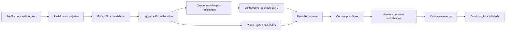

# Validação da recomendação por habilidades

Revisão: 17/11/2026. Entrega: 18/11 às 12h de Brasília. Os resultados abaixo distinguem implementação, teste local e comprovação com pessoas reais.

## O que está sendo validado

A IA escolhe até três habilidades necessárias e ordena até três aliadas pelas habilidades oferecidas. Não gera justificativa, perguntas nem mensagem. A mensagem do convite usa um modelo fixo editável. A decisão de enviar continua humana.

Problema: o acesso a redes profissionais pode dificultar encontrar uma pessoa para uma troca objetiva. Público: mulheres cis e trans e pessoas não binárias de diferentes áreas e momentos de carreira. Os estudos históricos da landing contextualizam o problema; não comprovam a necessidade nem a eficácia da aliadas.

Linha de base do produto: mapa fixo de objetivo → habilidades; ordenação por quantidade de habilidades em comum, menos convites recentes e sorteio. A área de formação não determina quem pode ajudar. Perfis antigos com `can_help` continuam no plano B até escolherem habilidades; não recebem habilidades ou consentimentos inventados.

## Critérios definidos antes das rodadas

Cada avaliadora considera os cinco critérios em conjunto:

1. As habilidades necessárias fazem sentido para o objetivo.
2. A primeira recomendada ajudaria de verdade.
3. A ordem faz sentido, considerando o pool disponível.
4. Só aparecem habilidades da lista e presentes nas candidatas.
5. Nenhum dado pessoal aparece.

Vereditos: **aprovado**, **ajustar** ou **reprovado**, com comentário. Caso aprovado = pelo menos **duas de três avaliadoras** marcaram aprovado. Taxas só incluem casos com três vereditos válidos; ausências são pendências. Meta proposta: 80% de casos aprovados, sem incidente de privacidade; não é resultado medido.

## Preencher os arquivos

- `validacao/pool.csv`: até 15 perfis reais, autorizados e anonimizados. Código C1…C15, situação, área, até oito ids de habilidades separados por `|` e consentimento `sim`. Não colocar nomes, fotos, contatos ou ids Supabase. O arquivo não faz concessão de consentimento por si só: guarde a autorização fora do repositório público.
- `validacao/casos.csv`: 20 casos reais higienizados, com código CASO01…CASO20, objetivo, apoio até 300 caracteres, situação, área, interesses e observação. Incluir três ou quatro difíceis: Outro, texto vago, necessidade sem habilidade no pool. A observação não vai à IA.
- Os dois arquivos contêm somente cabeçalho e uma linha-modelo comentada. Dados fictícios dos testes ficam em diretório temporário e são apagados.
- Chaves permitidas: `src/lib/professional.ts`; catálogo e mapa: `src/lib/habilidades.ts`, reexportados do arquivo compartilhado com o worker.

## Rodar sem alterar produção

O script usa o **mesmo SYSTEM, responseSchema com enums, minimização e validação** da Edge Function. O apoio bruto não sai para o Google: após retirar contatos/documentos, só são transmitidas expressões do catálogo. Isso protege nomes que um filtro de telefones não reconheceria, mas pode perder nuances; avaliar também essa limitação.

Configure a chave apenas no ambiente seguro local, nunca no CSV, Git ou chat. Use o mesmo modelo publicado, em projeto Google sem faturamento, e `GEMINI_FREE_TIER_CONFIRMED=true`.

```bash
deno run --allow-read --allow-write=validacao --allow-env \
  --allow-net=generativelanguage.googleapis.com \
  validacao/rodar.ts --rodada 1 --versao-prompt v1 --geracoes-produto-hoje 0

deno run --allow-read --allow-write=validacao --allow-env \
  --allow-net=generativelanguage.googleapis.com \
  validacao/rodar.ts --rodada 2 --versao-prompt v2 --geracoes-produto-hoje 0

deno run --allow-read --allow-write=validacao validacao/consolidar.ts
```

Substitua `0` pelo número real de gerações do produto naquele dia, conferido no painel. Some outras pastas/rodadas manuais. O script limita o consumo local e não deve ser executado em paralelo; não controla sozinho a soma de outros computadores e produção. Distribua 40 casos das duas rodadas em dias distintos para respeitar o limite de 30 gerações/dia e as cotas gratuitas reais. Não habilite cobrança. O script é **parte manual declarada**, não substitui as três execuções do gatilho pelo site.

Saídas: `avaliacao-rodada-N.csv`, com objetivo, apoio, habilidades, pool e indicação ordenada em português, colunas A1/A2/A3; `saidas-rodada-N.csv`, só código de caso, modelo, versão, tokens, hora e código de erro. Salva incrementalmente e não sobrescreve rodadas existentes.

SYSTEM_V2 está preparado e ainda é igual ao SYSTEM. Ajustá-lo depois dos comentários reais da rodada 1 e registrar a mudança. Usar os mesmos casos/pool na rodada 2; se mudarem, explicar a comparabilidade. Não fabricar melhoria.

## O que se perde sem a IA

O script gera `indicacoes_plano_B` para os mesmos casos sem nova chamada externa. As três avaliadoras registram também B1/B2/B3_veredito e comentário, usando os mesmos critérios. A consolidação informa:

- Taxa de aprovação de cada rodada e diferença em pontos percentuais.
- Casos em que a IA foi aprovada e a regra não foi, entre casos com ambos os métodos completamente avaliados.
- Casos em que a regra foi aprovada e a IA não foi; regressões entre rodadas.
- Comentários agrupados e vereditos faltantes.

No pitch, usar “A IA ajudou em X de Y casos comparáveis em que a regra não foi aprovada” **somente depois da avaliação real**. A hipótese é interpretar a necessidade para além do mapa fixo, não escrever mensagens mais bonitas.

## Três execuções reais da automação

Após publicação autorizada, duas ou mais participantes reais precisam: perfil aprovado/completo, habilidades, disponibilidade/canal compatíveis e consentimento novo de IA. Criar pedido pelo site → banco filtra → pg_net chama worker → Gemini ordena → resultado é salvo → usuária revisa → convite depende de clique. Não criar contas fictícias nem alterar habilidades/consentimento de outra pessoa para destravar uma demonstração.

Em Painel › IA e automações, guardar exportação higienizada de três jobs distintos: data, estado concluído, modelo, tokens, erro vazio e ids de execução/pedido (nunca ids de pessoas). Conferir modo `ia`, habilidades e candidata antes do convite. `regra`, falhas, stubs locais e aceite sem feedback não comprovam geração ou encontro.

| Execução | Resultado real | Evidência |
|---|---|---|
| 1 | Pendente de pool elegível com habilidades e consentimento | Não realizada nesta rodada |
| 2 | Pendente | Não realizada |
| 3 | Pendente | Não realizada |

## Entrevistas e demonstração

Entrevistas: quando precisou de uma conversa profissional; como buscou ajuda; se conseguiu; tempo gasto; o que tornaria a troca útil. Colher consentimento e só guardar síntese higienizada. Ainda não há resultados de entrevistas, linha de base de tempo ou benefício mensurado.

Pitch até cinco minutos: problema/público e evidência (45s), solução e quatro componentes (45s), demonstração até dois minutos, comparação IA × regra e validação (45s), custos/limitações/próximo passo (45s). Não apresentar metas como resultados.



## Evidências e pendências

Consulta somente de leitura em 17/11: havia seis perfis profissionais e cinco com consentimento legado; consulta seguinte encontrou sete disponíveis. O conjunto pode mudar durante os testes. Não existiam jobs nem tokens registrados nessas consultas. Os três secrets estavam presentes. Presença de secrets e confirmação da titular de projeto sem faturamento não comprovam cota ou resposta Gemini.

Testes locais: build/TypeScript, SQL/RLS, contratos de IA, worker Deno sem rede externa, navegador com Auth/API simulados, script com Gemini stub e duas rodadas sintéticas temporárias. Não equivalem a testes humanos nem a execução real da API.

| Requisito | Implementado | Comprovado | Pendente | Próxima ação |
|---|---|---|---|---|
| Banco com RLS e contatos após aceite | Sim | Testes locais de autorização | Revisão pós-publicação | Conferir políticas remotas |
| Automação por gatilho | Sim | Trigger/pg_net stub local | Três execuções reais | Participantes completarem habilidades |
| IA por habilidades | Sim | Esquema, minimização e rejeição locais | Resposta real da nova função | Executar com pool real consentido |
| Revisão humana antes do convite | Sim | Navegador simulado | Teste com participantes | Revisar e enviar pelo site |
| 20 casos e três avaliadoras | Instrumentos prontos | Script testado com stub | Preenchimento/avaliação reais | Preencher pool/casos e convidar avaliadoras |
| Duas rodadas e comparação IA × regra | Sim | Consolidação local | Resultados reais | Avaliar, ajustar SYSTEM_V2, repetir |
| Entrevistas e linha de base | Roteiro pronto | Sem coleta | Dados reais | Realizar entrevistas autorizadas |
| Benefício mensurável | Indicadores prontos | Sem resultado | Medições de utilidade/tempo | Coletar feedback sem presumir encontros |
| Custos e cenário 10× | Sim | Consumo DB consultado | Cotas/faturas atuais | Conferir fontes/painéis |
| LGPD e segurança | Controles/documentação | Testes locais | Configuração de senha vazada | Ver docs/SEGURANCA.md |
| Pitch e demonstração | Roteiro pronto | Sem ensaio real | Gravação até 2min dentro de 5min | Ensaiar fluxo publicado |
